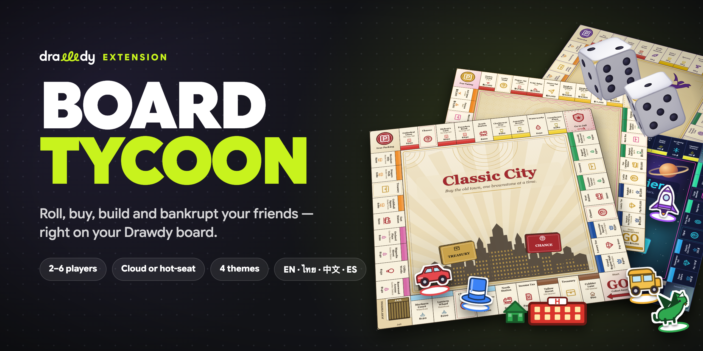
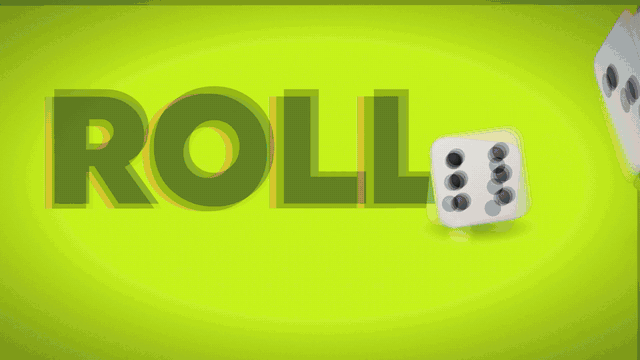

<p align="center"></p>

# Board Tycoon — Drawdy extension

Board Tycoon is a 2–6 player Monopoly-style property-trading game that runs on your Drawdy whiteboard, with cloud boards for remote friends and hot-seat play on one screen.

Install it, click the Board Tycoon toolbar button, create a game, invite friends to the cloud board, have them join, and start.

## Watch the trailer

<p align="center"><a href="docs/promo.mp4"></a></p>

<p align="center"><a href="docs/promo.mp4"><b>▶ Watch the full trailer (44 s)</b></a></p>

## How to use

1. Open the Board Tycoon panel from the toolbar button.
2. Pick a theme (Classic City, Thailand, Space Frontier, Fantasy Realm) and set the house rules.
3. Everyone on the board opens the panel and joins with a name, color and token. On one device, use "add local player" to add extra players for hot-seat play.
4. The creator starts the game.
5. Take turns. The panel shows whose turn it is and enables only the actions you can take.

### Controls

| Action | How |
| --- | --- |
| Roll | Roll the dice on your turn, using the primary action button |
| Buy or auction | Buy the property you landed on, or decline to start an auction |
| Build and sell | Build houses and hotels on full color groups, or sell buildings back to the bank |
| Mortgage | Mortgage an unbuilt property for cash, or pay to unmortgage it |
| Trade | Propose a trade of cash, properties and jail-free cards; the other player accepts, rejects or cancels |
| Jail options | Pay the jail fine, use a jail-free card, or roll for doubles |
| Debt and bankruptcy | When you owe more than you hold, sell, mortgage or trade your way out, or declare bankruptcy |
| Space or Enter | Primary action for the current step |
| Focus board | Fly the camera to the game board, or to one tile |

## Languages

English, Thai (ไทย), Chinese (中文) and Spanish (Español).

- **Game language**: picked when you create a game. The board, cards, scoreboard and game log use it for everyone at the table.
- **Panel language**: each player picks their own in the panel header. It defaults to your browser's language.

## Rules

The game uses the official US rules (2008 onward): movement, rent, property auctions, even building across color groups, rent collected in jail, and building supply limits. The house rules below change the defaults.

| House rule | Setting | Default |
| --- | --- | --- |
| Starting cash | `startingCash` | 1500 |
| GO salary | `salary` | 200 |
| Double salary on landing on GO | `doubleSalaryOnGo` | off |
| Free parking jackpot (taxes and fines go to a pot) | `freeParkingJackpot` | off |
| Auction when a property is declined | `auctionOnDecline` | on |
| Even building across a color group | `evenBuild` | on |
| Collect rent while in jail | `rentInJail` | on |
| Jail fine | `jailFine` | 50 |
| Round limit (0 = unlimited; highest net worth wins at the limit) | `roundLimit` | 0 |
| House supply | `houseSupply` | 32 |
| Hotel supply | `hotelSupply` | 12 |

## Themes

- **Classic City**: the classic city board, with streets, railroads and utilities.
- **Thailand**: Thai-themed names and art. Prices are shown ×100 in baht (฿).
- **Space Frontier**: a space-colony theme.
- **Fantasy Realm**: a fantasy theme with dungeons, portals and mana wells.

All themes share the same official economy, so they are equally balanced. Only the names, art and currency display change.

## Multiplayer

The game state is stored on the game's board frame and synced by Drawdy. One player's panel acts as the game host. If the host leaves the board, hosting passes automatically to another player. Each player only writes their own moves, so two players never overwrite each other's changes.

Works on cloud boards (multiplayer, with each player on their own device) and on local boards (hot-seat, with several players sharing one screen).

## Permissions

| Permission | Used for |
| --- | --- |
| `dom` | The toolbar button and the control panel |
| `scene` | Drawing the board, tokens, dice and houses |
| `collaboration` | Seeing who is on the board, so players can be seated and a host can be picked |

The extension has no storage access and makes no network requests.

## Development

```bash
npm install
npm run dev        # Add extension dev server in Drawdy's ⌘K palette (local boards only)
npm test           # engine tests
npm run webview    # regenerate the control panel HTML from webview/
npm run build      # produce dist/<driver-id>.drawdyx
```

Hot reload works only on local boards.

---

Board Tycoon is an independent fan-made game. It is not affiliated with, endorsed by or sponsored by Hasbro. MONOPOLY® is a registered trademark of Hasbro.

Trailer music: "Gimme that Groove!" by Michael Ramir C. ([Mixkit](https://mixkit.co/free-stock-music/)). Sound effects from [Mixkit](https://mixkit.co/free-sound-effects/) and [Kenney](https://kenney.nl/assets/casino-audio) (CC0).
